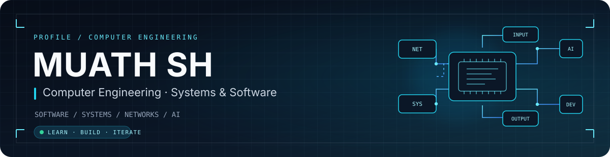
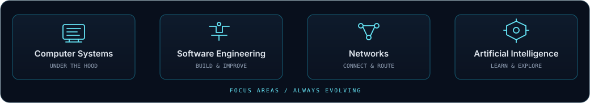

  

  
  
  

<em>Understanding systems. Building useful software. Exploring what comes next.</em>

---

## `01 / About`

I'm Muath, focused on computer engineering and how software and computer systems work together. I enjoy exploring ideas across **software engineering, networks, computer systems, and AI**—then turning what I learn into practical projects.

## `02 / Areas I Explore`

  

- **Computer systems** — understanding the layers beneath everyday software.
- **Software engineering** — building useful, maintainable tools.
- **Networks** — learning how devices and systems communicate.
- **Artificial intelligence** — exploring intelligent approaches to real problems.

## `03 / Featured Project`

### [USB-ports-controller](https://github.com/MuathSh/USB-ports-controller)

A cross-platform project for inspecting and controlling USB devices and ports on **Linux, Windows, and macOS**. It brings together device information, platform-specific backends, and a graphical interface.

 

## `04 / Learning`

**Systems Engineering and Programming Bootcamp** — Tuwaiq Academy

## `05 / GitHub Snapshot`

These cards pull public information from GitHub automatically, so the numbers and language breakdown can change as the profile changes.

  
  

  

### Contribution trail

The snake animation below is generated by GitHub Actions and refreshes automatically twice a day.

  <picture>
    <source media="(prefers-color-scheme: dark)" srcset="https://raw.githubusercontent.com/MuathSh/MuathSh/output/github-contribution-grid-snake-dark.svg" />
    <source media="(prefers-color-scheme: light)" srcset="https://raw.githubusercontent.com/MuathSh/MuathSh/output/github-contribution-grid-snake.svg" />
    
  </picture>

## `06 / Connect`

  

Designed around systems, engineering, and continuous learning.

